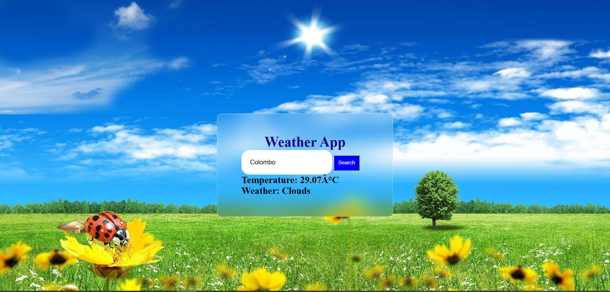

# Weather App

A simple weather application that displays weather information for a searched location.

## Features
- Search for a city
- View current weather information
- Simple and user-friendly interface

## Technologies Used
- HTML
- CSS
- JavaScript
- Weather API

## How to Run
1. Download or clone this project.
2. Open the project folder.
3. Open `index.html` in a web browser.
4. Enter a city name and search to view its weather.

## Screenshot

